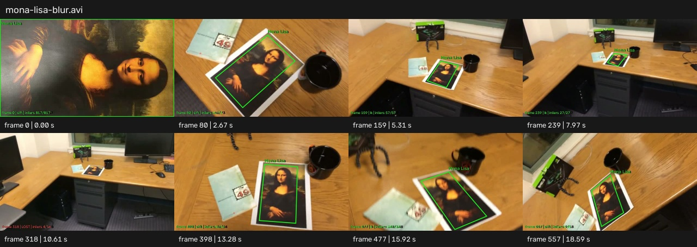
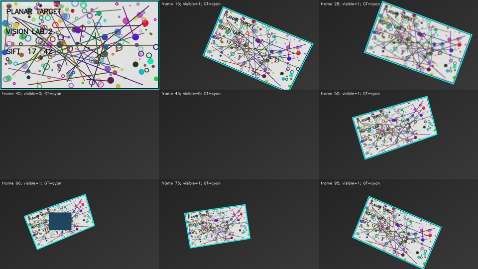

# Лабораторная работа №2. Трекинг плоского объекта по ключевым точкам

Реализация на **C++17 и OpenCV**: SIFT, гомография RANSAC и резервное сопровождение точек оптическим потоком. Программа получает видео, использует первый кадр как эталон объекта и на последующих кадрах рисует его перспективную рамку с подписью. При потере подтверждённых соответствий рамка скрывается; после возвращения объекта поиск возобновляется автоматически.

Проверены три исходных тестовых ролика. Пункт с собственным снятым видео пока **не выполнен: ролик ещё не записан**. Синтетический геометрический тест приведён отдельно и не заменяет собственную съёмку.

## 1. Теоретическая база

### Ключевые точки и SIFT

Ключевые точки описывают характерные локальные участки изображения: углы, пятна и текстурные детали. SIFT ищет экстремумы в масштабном пространстве, отбрасывает неустойчивые точки, определяет их ориентацию и формирует 128-мерный дескриптор локальных градиентов. Это позволяет сопоставлять объект при изменении масштаба и повороте. Сильное размытие, маленький размер объекта и слабая текстура уменьшают число устойчивых соответствий.

Эталонные дескрипторы сравниваются с дескрипторами текущего кадра по евклидовому расстоянию (`BFMatcher`, `NORM_L2`). Для каждого эталонного дескриптора находятся два ближайших соседа. Соответствие принимается, если

```text
d1 < 0.75 * d2,
```

где `d1` и `d2` - расстояния до первого и второго соседей. Этот ratio test отбрасывает неоднозначные совпадения. Повторное использование одной точки текущего кадра для нескольких эталонных точек запрещено.

### Гомография и RANSAC

Проекции плоского объекта в двух изображениях связаны гомографией - матрицей `H` размером 3×3:

```text
s * [u, v, 1]^T = H * [x, y, 1]^T.
```

У гомографии восемь независимых параметров; для её определения нужны как минимум четыре соответствия в невырожденной конфигурации. На практике используются дополнительные точки, поскольку совпадения содержат ошибки.

RANSAC многократно оценивает преобразование по малым выборкам и ищет согласованное подмножество соответствий (inliers). Порог ошибки репроекции равен 3 пикселям. По найденной матрице преобразуются четыре угла эталона. Поэтому рамка является четырёхугольником и соответствует перспективе объекта, а не только его осевому bounding box.

### Сопровождение точек Lucas-Kanade

Когда объект становится маленьким, его SIFT-дескрипторы могут перестать сопоставляться с эталоном. Уже найденные угловые точки можно сопровождать между соседними кадрами методом Lucas-Kanade (LK). Он оценивает сдвиг локальных участков, предполагая примерно постоянную яркость и близкое движение соседних пикселей. Пирамида изображений позволяет обрабатывать более крупные перемещения.

В реализации точка проводится вперёд и обратно. Она принимается при ошибке возврата меньше 1 px и средней фотометрической ошибке меньше 20 уровней яркости. Затем по оставшимся соответствиям снова оценивается гомография RANSAC; порог составляет 1,5 px, минимальная доля inliers - 0,6. Оптический поток также может накапливать дрейф, поэтому независимая локализация SIFT имеет приоритет.

## 2. Описание разработанной системы

```text
Первый кадр / ROI -> SIFT -> постоянный эталон дескрипторов и четырёх углов
                                  |
Каждый кадр -> SIFT -> kNN + ratio test -> RANSAC -> проверка геометрии
                                                        |
                            успех: новая привязка к эталону
                            неудача: LK предыдущих точек -> RANSAC -> проверки
                                                        |
                                рамка и подпись / отсутствие рамки
                                                        |
                             видео + покадровый CSV + JSON + иллюстрация
```

Эталон не обновляется и не заменяется предыдущим кадром. При инициализации создаются четыре его масштаба: 1, 1/2, 1/4 и 1/8. Ключевые точки всех уровней пересчитываются в координаты исходного эталона. Уменьшенные изображения дают грубые детали, которые сохраняются при удалении объекта от камеры. Для слишком маленького ROI уровни меньше 24 пикселей по любой стороне пропускаются.

Поиск SIFT выполняется по всему кадру на каждом шаге и позволяет повторно найти объект после исчезновения. Если он не дал подтверждённой рамки, применяется LK от предыдущего подтверждённого кадра. После успешной оценки внутри рамки выбирается до 150 углов Shi-Tomasi; через обратную гомографию им назначаются координаты эталона. При неудаче обеих ветвей состояние LK очищается. Перенос старой рамки без новых соответствий не используется.

Основные параметры по умолчанию:

| Параметр | Значение |
|---|---:|
| Максимум точек SIFT на кадр / один уровень эталона | 2500 |
| Порог контраста SIFT | 0,02 |
| Ratio test | 0,75 |
| Минимум уникальных совпадений | 10 |
| Минимум inliers | 8 |
| Минимальная доля inliers | 0,4 |
| Порог RANSAC | 3 px |
| Итерации / доверительная вероятность RANSAC | 2000 / 0,995 |

Дополнительно проверяются конечность координат, выпуклость, порядок углов, площадь и длины сторон рамки, её пересечение с кадром и пространственное распределение inliers. Локальная группа совпадений не должна задавать рамку всего объекта. Частичный выход объекта за границу кадра разрешён.

Первый кадр по условию содержит крупное изображение объекта, поэтому по умолчанию эталоном служит весь кадр. Если в нём есть фон, используется `--roi X Y WIDTH HEIGHT`. Рамка соответствует выбранной области эталона: невидимые в первом кадре белые поля бумаги автоматически не восстанавливаются.

Структура проекта:

| Файл | Назначение |
|---|---|
| `include/planar_tracker.hpp` | Параметры, результат локализации и интерфейс трекера |
| `src/planar_tracker.cpp` | SIFT, LK, сопоставление, RANSAC и проверка рамки |
| `src/main.cpp` | Аргументы, видео, визуализация и сохранение результатов |
| `tests/test_tracker.cpp` | Автоматические тесты геометрии, потери и восстановления |
| `tools/run_all.sh` | Сборка, CTest и три исходных ролика |
| `tools/generate_synthetic.py` | Подготовка дополнительного теста с известной геометрией |
| `tools/evaluate_synthetic.py` | Расчёт ошибки углов и IoU по разметке |

### Сборка и запуск

Нужны компилятор C++17, CMake 3.16+ и OpenCV 4.4+ или 5.x с поддержкой видеокодеков.

macOS:

```bash
brew install cmake opencv
```

Ubuntu/Debian:

```bash
sudo apt install build-essential cmake libopencv-dev
```

Из корня проекта:

```bash
cmake -S . -B build -DCMAKE_BUILD_TYPE=Release
cmake --build build --parallel
ctest --test-dir build --output-on-failure

./build/lab2_tracker --input test-videos/mona-lisa.avi \
  --output-dir results/mona-lisa --label "Mona Lisa"
```

Справка: `./build/lab2_tracker --help`. Параметр `--display` открывает окно; `Q` или `Escape` останавливают обработку. Без него программа работает без графического интерфейса. Можно изменить пороги через `--ratio`, `--ransac`, `--min-matches`, `--min-inliers`. Флаг `--no-flow` отключает резервную ветвь LK для сравнения с SIFT. Для подписи следует использовать ASCII: встроенный шрифт OpenCV не поддерживает кириллицу.

Три исходных видео из задания нужно поместить в `test-videos/`. Они не включены в Git. `simple_track.avi` содержит готовую разметку и используется как демонстрационный образец, а не как чистый вход для оценки.

```bash
bash tools/run_all.sh
# Если видео находятся в другой папке:
bash tools/run_all.sh /path/to/test-videos
```

Для каждого ролика сохраняются `annotated.avi` (MJPG, исходный FPS и размер), `tracking.csv`, `summary.json` и `contact_sheet.jpg`. В опубликованном отчёте также есть компактные MP4-копии. Большие AVI остаются локально и исключены из Git.

CSV содержит номер и время кадра, причину результата, метод (`sift`, `lk`, `none`), число совпадений и inliers, долю inliers, медианную ошибку репроекции, время обработки и четыре угла рамки в порядке TL, TR, BR, BL относительно эталона. Для LK совпадениями считаются точки, прошедшие проверку потока. При потере объекта координаты пустые. JSON содержит параметры запуска и сводные показатели. Программа сообщает об ошибках входа, ROI, эталона без текстуры и создания результатов.

## 3. Результаты работы и тестирования

Проверка выполнена на macOS 26.2 arm64, C++17 (AppleClang 21), OpenCV 5.1.0, Release. Каждый исходный ролик имеет 558 кадров, разрешение 640×360 и частоту 29,97 FPS. Первый кадр также обрабатывается и включён в статистику. Эталон содержит 1191 точку для первых двух роликов и 1224 для extra-credit (суммарно по масштабам).

| Вход | Кадров | Через SIFT | Через LK | Всего с рамкой | Покрытие | FPS обработки |
|---|---:|---:|---:|---:|---:|---:|
| `mona-lisa.avi` | 558 | 299 | 196 | 495 | 88.71% | 24.20 |
| `mona-lisa-blur.avi` | 558 | 280 | 196 | 476 | 85.30% | 24.61 |
| `mona-lisa-blur-extra-credit.avi` | 558 | 257 | 206 | 463 | 82.97% | 24.93 |

Покрытие - доля кадров, для которых алгоритм принял рамку. Это **не accuracy и не IoU**: у исходных роликов нет отдельной разметки истинных углов. Маленькая ошибка репроекции inliers также не является ошибкой углов относительно разметки. FPS учитывает локализацию и подготовку состояния LK, исключает декодирование, отрисовку и запись; процессы тестирования частично запускались параллельно, поэтому это ориентировочное измерение, а не строгий бенчмарк.

На обычном ролике SIFT без LK с той же пирамидой эталона давал рамку на 299/558 кадрах (53,58%). Резервная ветвь LK добавила 196 кадров и увеличила покрытие до 88,71%. Это улучшение покрытия само по себе не доказывает точность всех добавленных рамок. На просмотренных контрольных кадрах рамка соответствует изображению картины; длинные участки сопровождения остаются чувствительными к дрейфу.

Общий проблемный участок обычного ролика - кадры 302–364: маленький объект и недостаток подтверждённых точек после потери сопровождения. На кадре 365 SIFT заново находит объект. В роликах с размытием появляются дополнительные пропуски. Для задания не заявляется безошибочное обнаружение на каждом кадре.

**Обычное видео:**


[Аннотированное видео MP4](results/mona-lisa/preview.mp4), [покадровые данные](results/mona-lisa/tracking.csv), [сводка и параметры](results/mona-lisa/summary.json).

**Размытие:**



[Аннотированное видео MP4](results/mona-lisa-blur/preview.mp4), [покадровые данные](results/mona-lisa-blur/tracking.csv), [сводка и параметры](results/mona-lisa-blur/summary.json).

**Дополнительный сложный ролик:**


[Аннотированное видео MP4](results/mona-lisa-blur-extra-credit/preview.mp4), [покадровые данные](results/mona-lisa-blur-extra-credit/tracking.csv), [сводка и параметры](results/mona-lisa-blur-extra-credit/summary.json).

### Автоматические проверки и синтетический тест

Восемь C++-тестов проверяют невалидный эталон, известную гомографию, масштаб/поворот/перспективу, пустой кадр и постороннюю текстуру, исчезновение/возвращение, перекрытие, выход за край кадра и сопровождение уменьшающегося объекта. Проверки действуют и в Release, поскольку не зависят от `assert`.

В последнем тесте объект постепенно уменьшается примерно до 50×36 px за 110 кадров. Кадры перед уменьшением фильтруются против алиасинга. Все 110 кадров локализованы; как минимум один кадр принят через LK, когда SIFT без LK не даёт рамку. Максимальная ошибка отдельного угла по известной геометрии - 5,40 px для SIFT и 1,48 px для LK при контрольном пределе 7 px. После двух пустых кадров рамка отсутствует, а вернувшийся объект находится через SIFT.

Дополнительно сгенерирован независимый ролик из 96 кадров с перспективой, поворотом, изменением масштаба, размытием и перекрытием. Объект отсутствует на кадрах 40–49 и возвращается на кадре 50. Координаты всех углов заданы генератором, поэтому здесь можно вычислить геометрическую ошибку:

| Показатель | Результат |
|---|---:|
| Обнаруженные видимые кадры | 86 / 86 |
| Ложные рамки при отсутствии объекта | 0 / 10 |
| Средняя ошибка углов по найденным кадрам | 0.151 px |
| Максимальная средняя ошибка четырёх углов одного кадра | 0.292 px |
| Средний IoU по видимым кадрам, пропуски считаются нулём | 0.9983 |
| Восстановление на первом кадре возвращения (50) | да |



[Аннотированное синтетическое видео](results/synthetic/preview.mp4), [истинные углы](results/synthetic/ground_truth.csv), [результаты оценки](results/synthetic/evaluation.json), [покадровые ошибки](results/synthetic/errors.csv). Этот ролик проверяет алгоритм на контролируемой геометрии и не является собственной видеосъёмкой. Все 86 видимых кадров этого отдельного ролика найдены через SIFT; ветка LK отдельно проверяется C++-тестом уменьшения.

Для воспроизведения дополнительного теста Python нужен только как инструмент генерации данных и оценки; трекер и его автоматические тесты написаны на C++:

```bash
python3 -m venv .venv
source .venv/bin/activate
python3 -m pip install -r tools/requirements.txt
python3 tools/generate_synthetic.py
./build/lab2_tracker --input results/synthetic/input.avi \
  --output-dir results/synthetic --label "Planar target"
python3 tools/evaluate_synthetic.py
```

Компактные MP4 можно пересоздать командой `bash tools/make_previews.sh` (нужен FFmpeg). Они предназначены для просмотра; оценка выполняется по CSV исходного прогона.


### Собственное снятое видео

Этот пункт остаётся открытым до съёмки. Нужно снять текстурный плоский объект (например, обложку книги), показать его крупно в первом кадре, затем менять расстояние и ракурс. Если первый кадр включает фон, следует указать ROI. Команда для последующей проверки:

```bash
./build/lab2_tracker --input /path/to/own-video.mp4 \
  --output-dir results/own-video --label "Book"
# При необходимости добавить: --roi 30 20 500 300
```

После запуска в отчёт необходимо добавить полученные показатели и иллюстрацию. Результаты собственного видео не выдумывались.

## 4. Выводы

Реализован трекер плоского текстурного объекта на основе ключевых точек SIFT, LK и робастной оценки гомографии. Перспективное преобразование позволяет рисовать рамку при поворотах, изменении масштаба и ракурса. Независимый поиск относительно исходного эталона даёт восстановление после потери и корректирует дрейф, а оптический поток поддерживает сопровождение при уменьшении объекта.

Метод ограничен видимостью локальной текстуры. При сильном размытии, очень маленьком объекте, значительном перекрытии и слабом числе совпадений рамка может исчезать. Длинные последовательности LK без повторного подтверждения SIFT могут накапливать дрейф. Выбранное поведение скрывает неподтверждённую рамку. Возможные улучшения - более устойчивые дескрипторы, несколько эталонных ракурсов и проверка внешнего вида области объекта. Неплоский или деформируемый объект одной гомографией в общем случае не описывается.

## 5. Использованные источники

1. [OpenCV - Introduction to SIFT](https://docs.opencv.org/4.x/da/df5/tutorial_py_sift_intro.html).
2. [OpenCV - Feature Matching](https://docs.opencv.org/4.x/dc/dc3/tutorial_py_matcher.html).
3. [OpenCV - Feature Matching + Homography to find Objects](https://docs.opencv.org/4.x/d1/de0/tutorial_py_feature_homography.html).
4. [OpenCV - Camera Calibration and 3D Reconstruction (`findHomography`)](https://docs.opencv.org/4.x/d9/d0c/group__calib3d.html).
5. [OpenCV - переход с версии 4 на 5](https://github.com/opencv/opencv/wiki/OpenCV-4-to-5-migration).
6. [OpenCV - Optical Flow, Lucas-Kanade](https://docs.opencv.org/4.x/d4/dee/tutorial_optical_flow.html).
7. [OpenCV - `calcOpticalFlowPyrLK`](https://docs.opencv.org/4.x/dc/d6b/group__video__track.html).
